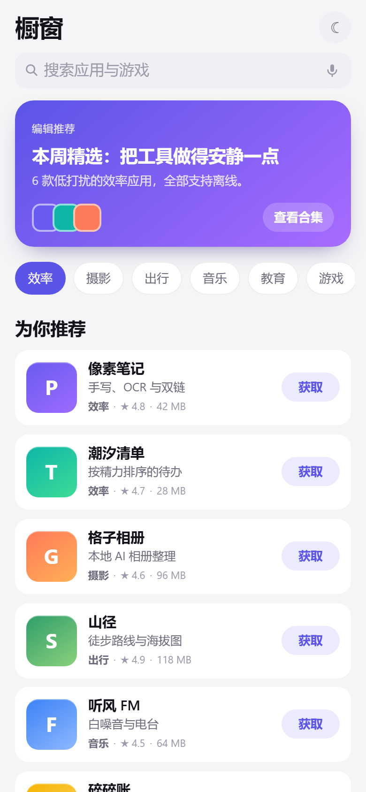
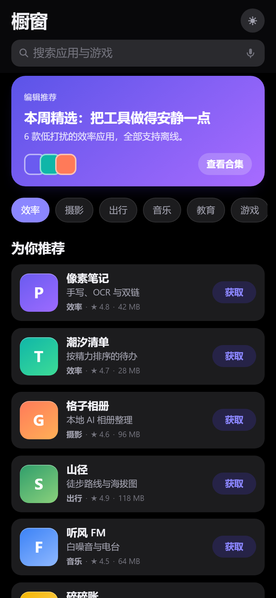

# Storefront UI

一个干净、可教学的应用商店界面 Demo：原生 HTML / CSS / JavaScript，**零依赖、零构建**，双击 `index.html` 就能跑。

所有应用名、图标、数据均为虚构示例，与任何真实厂商、商店或应用无关。

<p>
  
  
  
</p>

## 特性

- 首页：编辑推荐大卡、分类 chips、「为你推荐」统一列表、热门排行
- 搜索：热门词建议、边输边筛、关键词高亮、空结果提示
- 深色模式：跟随系统，可手动切换并记住选择
- 首屏骨架屏 → 内容淡入，数据到达时不发生布局跳动
- 单文件组件式结构，无框架依赖，方便逐段讲解

## 运行

```bash
# 方式一：直接打开
open index.html          # macOS
start index.html         # Windows

# 方式二：本地静态服务（推荐，行为更接近真机）
python -m http.server 5173
# 然后访问 http://localhost:5173
```

## 目录结构

```
.
├── index.html   结构：顶栏 / 搜索框 / 骨架屏 / 首页 / 搜索结果
├── app.css      样式：设计变量 → 基础 → 顶栏 → 骨架 → 列表 → 深色适配
├── app.js       交互：渲染、搜索、输入法、主题、滚动阴影
├── data.js      虚构示例数据（换成你自己的接口即可）
└── LICENSE
```

## 四个值得单独讲的实现细节

### 1. 骨架屏到内容的过渡

数据到达前用与真实行结构一致的骨架占位（同样的图标尺寸、行高、间距），内容替换时高度不变，因此不会出现「闪一下、跳一下」。流光动画只跑 `transform`，不触发重排：

```css
.sk-icon::after { transform: translateX(-100%); animation: shimmer 1.25s infinite; }
@keyframes shimmer { to { transform: translateX(100%); } }
```

### 2. 输入法（IME）组合期间的稳定性

中文输入时 `input` 会在拼音逐字上屏时连续触发。如果每次都同步过滤并重建列表，就会在 IME 提交那一帧里面同时发生「文本变更 + DOM 重建 + 重排」，肉眼看到的是搜索框掉一下再弹回。

处理方式：

- `compositionstart` 打标记，组合中的 `input` 一律忽略；
- `compositionend` 里更新关键词，再 `requestAnimationFrame` 提交一次渲染，把重排移到下一帧；
- 组合期间的防抖时间放宽到 260ms。

### 3. 打字时光标卡顿

顶栏用了 `backdrop-filter` 毛玻璃。光标每闪一次，浏览器都要重新计算这个模糊层，输入框区域就会被反复合成，观感就是「打字卡」。

进入输入态时给顶栏加 `.is-editing`，直接把模糊换掉：

```css
.topbar.is-editing {
  -webkit-backdrop-filter: none;
  backdrop-filter: none;
  background: var(--bg);   /* 实色，和页面背景一致，视觉上几乎无差别 */
}
```

另一个常见诱因：输入框字号小于 `16px` 时 iOS 会自动放大视口，造成整页抖动，所以 `input` 固定到 `16px`。

### 4. 结果集签名比对

每次按键都 `innerHTML = ...` 重建十个节点，是卡顿的另一个源头。这里给结果算一个签名，签名不变就直接返回：

```js
const signature = keyword.trim() + '|' + items.map(a => a.id).join(',');
if (signature === state.lastSignature) return;
```

滚动阴影也没有监听 `scroll`，而是用 `IntersectionObserver` 观察内容顶部的一个哨兵元素，只在跨界时切一个 class。

## 想继续扩展

- 列表虚拟化（几千条时才有必要）
- 路由：把 `state.mode` 换成 hash 路由
- 数据层：把 `data.js` 换成 `fetch()` + 缓存
- 无障碍：`role="listbox"` 的搜索建议、键盘上下选择

## License

MIT，见 `LICENSE`。
